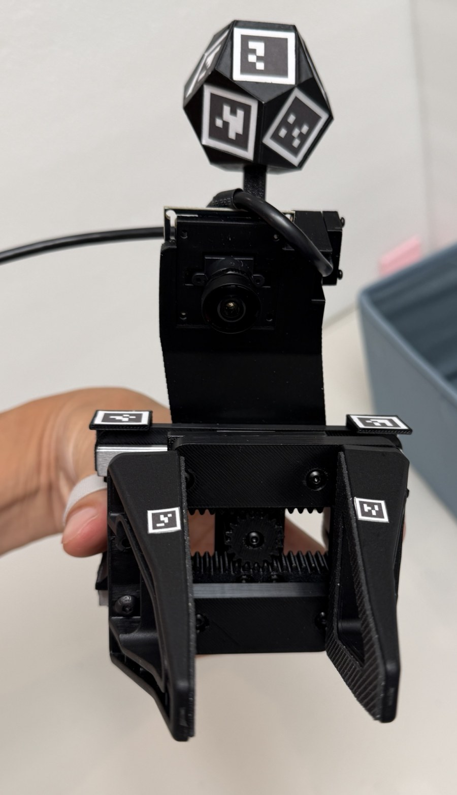
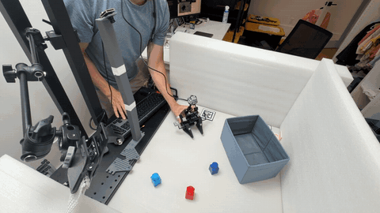
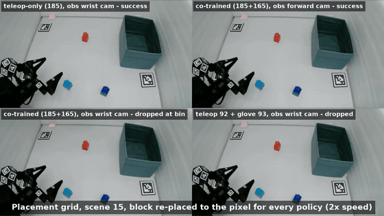

# YAM-UMI

An open-source, hand-worn [UMI](https://umi-gripper.github.io/)-style data
collection device for the **[I2RT YAM](https://i2rt.com/products/yam-6-dof-arm)
arm's linear gripper**.

> **Paper and video:**
> [YAM-UMI: A Fiducial-Tracked Glove that Collects Metrically Labelled Demonstrations for the YAM](paper/main.pdf) (preprint) ·
> [2.5-minute video](media/yam-umi-paper-video.mp4) ·
> [LaTeX source and figures](paper/)

  
  

<em>Left: the glove, with the robot's own gripper fingers, the fiducial ball, the marker cubes and the wrist fisheye.
Right: one demonstration at 1.5× speed (click for the <a href="media/glove-collection-demo.mp4">full 63-second clip</a>).</em>

  

<em>Placement-grid evaluation on the YAM at 2× speed, one placement, four policies: teleop-only (top left),
co-trained forward camera (top right), co-trained wrist camera (bottom left), half-teleop mix (bottom right).
Continuous rollouts of a single policy: <a href="media/rollout-demo-1x-720p.mp4">normal speed</a> or <a href="media/rollout-demo-6x-720p.mp4">6× speed</a>.</em>

| | |
|---|---|
| **Ergonomics** | 355 g on the hand with cable (318 g without), under half of UMI's 780 g; nothing to initialise |
| **Dexterity** | the YAM gripper's tasks (parallel-jaw pick, place, insert); 0–86 mm measured opening with the robot's own fingers; achievable opening depends on the wearer's hand shape |
| **Strength** | 1 kg by a jug handle, 1.5 kg slips, 2 kg no (the robot: 1.5 kg / 2 kg); MGN9 rails, no wear in a month |
| **Labels** | absolute 6-DoF pose and jaw width every frame from printed fiducials; 7.7 mm / 1.7° median against the robot's kinematics |
| **Reproducibility** | hardware and software open; one two-plate print, 7 purchased parts; three units built, one by others |
| **Cost** | $79 per glove ($22 without the wrist camera); $122 of shared rig; about $200 per system vs UMI's $371 |

YAM-UMI mirrors the YAM linear gripper's jaw geometry, reuses the YAM wrist camera
mount, and reproduces the gripper's own rail-and-pinion mechanism, so **the
camera pose relative to the gripper tips, and the way those tips move, are the
same during data collection as on the deployed robot**. Aperture is recovered
from fiducial markers rather than a servo encoder, so there is no motor to
backdrive and no loaded plastic linkage to fail.

> **Status:** hardware, collection, calibration, dataset generation, and policy
> training have been demonstrated. About 170 glove episodes have been collected;
> the [paper](paper/main.pdf) evaluates 165 glove episodes alongside 185
> teleoperated episodes. See [Status and limitations](#status-and-limitations).

## Why another UMI variant

The point of a UMI-style rig is to collect demonstrations without a robot in the
loop, then train a policy that consumes wrist-camera images. That only works if
what the camera sees at collection time resembles what it sees at deployment
time.

YAM-UMI keeps the robot's stock gripper fingers and camera mount, and adapts the
handheld device to match them. The current hardware targets the YAM linear
gripper; adapting it to another gripper would require matching that gripper's
geometry and camera placement.

This design began as an attempt to use
[HandUMI](https://github.com/murobotics-ai/handumi-hw) on a YAM. HandUMI is one
of the open hand-worn UMI designs with **synchronized jaws**. Its camera
placement and lever linkage needed changes for the YAM.

### 1. The camera extrinsic could not be matched

HandUMI uses a shared body with interchangeable gripper tips and software
retargeting for different arms. Its camera mount does not readily reproduce
the YAM camera's angle relative to the gripper tips.

YAM-UMI instead reuses the YAM gripper's own fisheye camera mount on a body that
reproduces the YAM jaw geometry, so the camera-to-tip transform is matched by
construction rather than corrected in software. Because the device also accepts
the **actual gripper tips that ship with the YAM arm**, the jaws occlude the same
part of the frame, the aperture-to-pixel mapping is the same, and the contact
patch on the object is the same.

### 2. The servo and the lever linkage

HandUMI measures aperture with a Feetech servo encoder. Backdriving its gear
train adds friction during pinching. In our build, the printed lever parts also
popped out of the mechanism during normal use.

YAM-UMI carries the motion on two MGN9 linear rails instead, with a single pinion
between two racks — one rack per jaw — to keep the jaws synchronized.

This matches the YAM gripper's mechanism: both jaws move symmetrically about
the same centerline.

Aperture is read from fiducial markers on the tips, the approach the original UMI used.
Consequences:

- **No backdrive friction.** The pinch is governed by the rails and the
  rack-and-pinion coupling only.
- **No servo, controller, or power supply** in the bill of materials, and no
  cable routing for them.
- **No loaded lever linkage.** The printed parts are brackets and mounts, not
  structural links carrying the pinch load.

## What it records

| Signal | Source |
|---|---|
| Wrist pose, SE(3) | Dodecahedral ArUco marker ball and gripper-back markers observed by an external camera |
| Gripper aperture | 6 mm AprilTag (16h5) markers on the gripper tips, seen by the wrist fisheye camera |
| Wrist-view video | Fisheye USB camera on the YAM camera mount |

The evaluated setup uses a fixed external camera to recover absolute pose from
fiducials, without SLAM or an IMU. The wrist fisheye records the grasp and reads
the tip markers for aperture. Recording, calibration, labelling, and dataset
construction are provided by
[forward-cam-umi](https://github.com/YosubShin/forward-cam-umi/blob/main/scripts/README.md).

### Dodecahedral wrist tracker

The external camera tracks the marker ball and the gripper-back markers. The
back markers were originally paired with tail markers for external-camera
aperture measurements; they also provide a pose fallback when the hand hides
the ball. Collection must remain within the cameras' view.

Measured with the ball at roughly 94 cm standoff, **on settled holds**:

| Metric | Result |
|---|---|
| Within-hold precision | 0.46 mm RMS (median), p90 0.68 mm |
| Revisit repeatability | 0.08–0.17 mm SD per axis (lateral 0.12, depth 0.17) |

Coverage — the fraction of frames with enough faces visible to solve a bundle
pose — depends strongly on the external camera:

| Camera | ≥1 face | ≥2 faces | ≥3 faces |
|---|---|---|---|
| Sony (4K 30p, H.264) | 100% | 90.8% | 77.5% |
| Arducam B0591 (1080p, focus locked via v4l2) | 79.6% | 68.3% | 59.1% |

**Update (2026-09):** both of the original caveats — settled-holds-only, and
absolute pose unresolved — have since been resolved by measuring this same
ball design on the real YAM arm against its joint encoders. During full-speed
teleoperated manipulation (30 episodes, ~23k frames), fused-ball pose agrees
with the robot's forward kinematics to **7.7 mm median / 22.7 mm p95 / 1.7°**
at a tool point 13 cm from the ball, with pose solved in 98.5% of frames;
the error budget is dominated by the hand-eye calibration (4.8 mm residual),
not the camera. The earlier 14%/9° discrepancies were extrinsics error, fixed
by a proper `calibrateRobotWorldHandEye` solve harvested from ordinary
episodes. Full numbers, method, and known failure modes:
[`pos-tracking/dynamic-accuracy.md`](pos-tracking/dynamic-accuracy.md).

The Arducam coverage was measured before mount or field-of-view tuning.

See [`pos-tracking/README.md`](pos-tracking/README.md) for the build and
calibration procedure.

The third-party [tinyumi Quest-controller mount](https://github.com/vovw/tinyumi/blob/main/pos-tracking/quest_mount/handumi_v1/README.md)
provides an alternative pose source. It requires that fork's revised base plate
and mounting hardware and has not been tested by the YAM-UMI authors.

## Design updates

### 2026-10-01 — Adapter v11

- Removed the adapter boss so the jaw adapter clears the rail's rubber end caps
  without cutting them. Keep the caps intact to prevent the carriages from
  running off the rails and losing their ball bearings.
- Replaced adapter v10 with the v11 [STEP](hardware/STEP/adapter_v11.step) and
  [STL](hardware/STL/adapter_v11.stl) files.

### 2026-09-28 — L bracket v4 and handle v14

- Updated the L bracket to mitigate plate bending when squeezing the glove hard.
- Changed gripper fastening from M4 bolts and nuts to M4 screws with heat-set
  inserts to make assembly easier.
- Updated the [STEP](hardware/STEP/L_bracket_v4.step) and
  [STL](hardware/STL/L_bracket_v4.stl) files, replacing v3.
- Updated the handle to v14, removing the side hole for an M4 nut. The handle
  attaches to the L plate with an M3 screw and heat-set insert; the remaining
  M4 hole serves only to prevent the handle from rotating in place.
  Updated the [STEP](hardware/STEP/handle_v14.step) and
  [STL](hardware/STL/handle_v14.stl) files, replacing v13.

## Parts

### Gripper body — [`hardware/`](hardware/)

Printed parts are provided as STEP and STL. The STEP files are the source of
truth; the STLs were tessellated from them at 0.05 mm chordal tolerance and are
watertight, so re-export from STEP if you want a different resolution.

| Part | Size (mm) | Role |
|---|---|---|
| `plate_v6` | 102 × 65 × 10.4 | Main plate; carries both linear rails, the camera arm, and the pinion axle |
| `adapter_v11` | 50 × 25.9 × 10.6 | Carriage-to-jaw adapter; presents the YAM gripper tip interface |
| `pinion_z18_deep_v0`–`v3` | ⌀20.0–19.7 × 10.6 | Module 1, z=18 spur pinion coupling the two jaw racks for symmetric motion, as in the YAM gripper. Four fit variants — see [Printing](#printing) |
| `handle_v14` | 32 × 17 × 55 | Operator handle |
| `L_bracket_v4` | — | Sits between the gripper finger and carriage adapter and connects to the handle |
| `YAM_linear_gripper_fisheye_camera_mount` | — | Fisheye camera mount, matching the YAM wrist camera pose |

<!-- TODO: verify the remaining plate, adapter and handle descriptions against
     the assembled hardware. The L bracket role is confirmed by the designer. -->

**Gripper tips are not printed.** Use the "Linear 4310" tips that ship with the
YAM arm to match the robot's contact geometry. If you
do not have spares, I2RT sells them as
[Gripper Tips (for Linear-Gear Style Gripper)](https://i2rt.com/products/gripper-tips-for-linear-gear-style-gripper)
($69), though they are frequently out of stock.

### Position tracking — [`pos-tracking/`](pos-tracking/)

See [`pos-tracking/README.md`](pos-tracking/README.md) for marker specifications
and printing instructions.

- `wrist_dodecahedron_marker/` — the dodecahedral marker ball (51 mm across),
  its stalk, arc adapter, and extender.
- `glove_markers_v4.pdf` — the marker sheet: 15 mm ArUco markers for the ball
  and the 6 mm AprilTag tip markers used for aperture sensing from the wrist
  fisheye camera.

The eleven markers can be placed in any arrangement on the ball. Calibrate each
unit to recover its face-to-ID mapping and account for printing and placement
tolerances.

The marker sheet also carries tail and base markers for
[forward-cam-umi](https://github.com/YosubShin/forward-cam-umi), which provide
occlusion backup and external-camera aperture measurements. These require
additional printed parts; see
[optional forward-camera extensions](pos-tracking/README.md#optional-forward-camera-extensions).

## Build

- [Bill of materials](bom/README.md) — ~$79 per gripper in parts, plus shop supplies (filament, fastener kits, tape) if you are starting from nothing.
- [Assembly](docs/assembly.md) — build order and fastener placement.

### Printing

The reference build was printed in **PETG** on a Bambu Lab X2D with the stock
PETG profile and *Support for PLA/PETG* enabled. Only support settings were
adjusted.

**The pinion comes in four variants.** `pinion_z18_deep_v0`–`v3` are the same
18-tooth, module-1 pinion at descending outside diameter — 20.0, 19.9, 19.8 and
19.7 mm — a 0.1 mm clearance ladder against the racks. **Print all four on one
plate and pick the one that runs smoothest** in your assembly. Fit varies with
printer, filament, and insert alignment; `v3` worked best in the reference build.

## Status and limitations

- **Glove collection and training:** about 170 glove episodes have been
  collected and processed with the
  [forward-cam-umi workflow](https://github.com/YosubShin/forward-cam-umi/blob/main/scripts/README.md).
  The [paper](paper/main.pdf) evaluates 165 glove episodes and 185 teleoperated
  episodes. Adding glove data lowers validation loss, but does not significantly
  improve rollout success in the reported evaluation.
- **Pose accuracy:** robot-mounted validation over 30 episodes measured
  7.7 mm median position error and 1.7° median orientation error against the
  robot's forward kinematics, with pose solved in 98.5% of frames. These numbers
  describe that validation setup, not coverage for every glove session. See
  [`pos-tracking/dynamic-accuracy.md`](pos-tracking/dynamic-accuracy.md).
- **Calibration:** camera intrinsics, ball geometry, and gripper-marker
  calibration commands are published in
  [forward-cam-umi](https://github.com/YosubShin/forward-cam-umi/blob/main/scripts/README.md).
  Robot-side hand-eye calibration and dataset construction also require the
  robot's kinematics.
- **Aperture calibration:** caliper measurements at several openings across the
  operating range (for example, four) establish the mapping from image-marker
  measurements to aperture, with intermediate values interpolated. The paper
  reports 0.9 mm holdout RMS for the spacer-based calibration.
- **Occlusion handling:** missing aperture readings are interpolated between
  available measurements. For pose, the gripper-back markers provide a fallback
  when the dodecahedral ball is hidden. Interpolated readings are estimates,
  distinct from frames with directly observed markers; the aperture calibration
  error above is not a separate measurement of error during occlusion.
- **Embodiment matching:** YAM-UMI is designed specifically to match the YAM
  linear gripper's fingers and camera-to-gripper transform at deployment. The
  design may serve as a starting point for other linear grippers, with changes
  to the gripper fingers and camera mounting geometry to match the target robot.
- **Second-hand support:** the ArUco 4×4, 100-marker dictionary was chosen to
  leave IDs available for a second hand; a complete two-hand setup has not been
  evaluated here.

## Related work

- **[UMI](https://umi-gripper.github.io/)** (Chi et al.,
  [arXiv:2402.10329](https://arxiv.org/abs/2402.10329)) — the original handheld
  gripper, the source of both the fiducial-based aperture sensing this design
  returns to and the principle of minimizing the observation embodiment gap.
  UMI achieves that match by mounting its own fingers and camera on the robot;
  YAM-UMI reverses the direction.
- **[HandUMI](https://github.com/murobotics-ai/handumi-hw)** (Murobotics) — the
  direct starting point for this work, and one of the few open hand-worn UMI
  designs with a synchronized parallel-jaw mechanism. YAM-UMI takes the
  glove-style form factor and the hook-and-loop finger retention from it, and
  diverges on camera placement, jaw mechanism, and aperture sensing for the
  reasons above. If you want a robot-agnostic rig rather than a YAM-specific one,
  or a direct encoder reading of aperture, HandUMI is the better fit. No HandUMI
  CAD is used here.
- **[Generalist](https://generalistai.com/)** — the wearable data-collection
  approach HandUMI credits as its own motivation.

### The robot this targets

- **[YAM 6-DOF arm](https://i2rt.com/products/yam-6-dof-arm)** (I2RT Robotics) —
  the arm YAM-UMI is built for. 6 DOF, 2 kg payload.
- **[YAM documentation](https://doc.i2rt.com/products/yam)** — specifications and
  setup for the arm and its linear gripper.
- **[`i2rt-robotics/i2rt`](https://github.com/i2rt-robotics/i2rt)** — the Python
  client library, URDF, and robot meshes. The meshes there are what this design's
  gripper geometry and camera mount are dimensioned from; see
  [THIRD_PARTY_NOTICES.md](THIRD_PARTY_NOTICES.md).

## License and attribution

This project is released under the [MIT License](LICENSE).

Geometry in this repository is dimensioned from mesh files published by I2RT
Robotics under the MIT License. See
[THIRD_PARTY_NOTICES.md](THIRD_PARTY_NOTICES.md) for the full attribution.

**This project is not affiliated with, endorsed by, or sponsored by I2RT
Robotics.** "YAM" is used only to identify the robot arm this hardware is
designed for.
