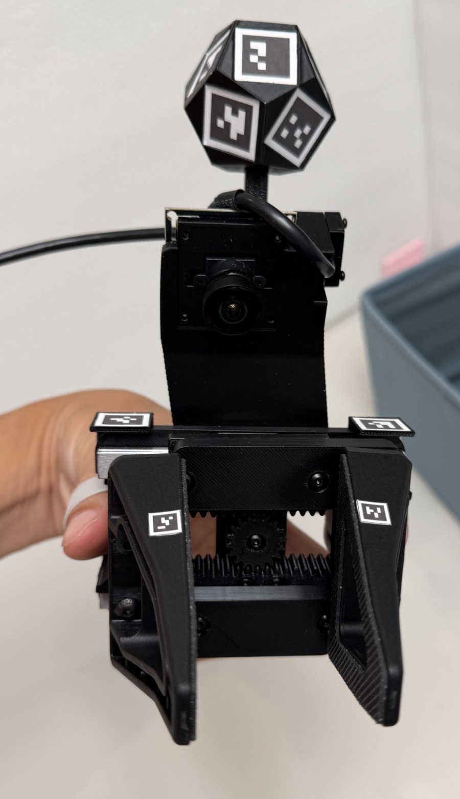
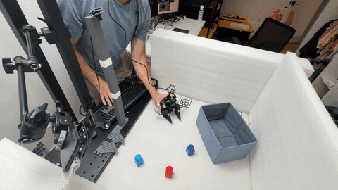
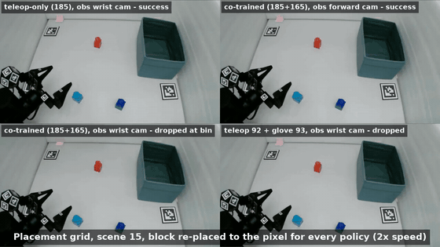

# YAM-UMI

An open-source, hand-worn [UMI](https://umi-gripper.github.io/)-style data
collection glove for the **[I2RT YAM](https://i2rt.com/products/yam-6-dof-arm)
arm's linear gripper**. It carries the robot's own gripper fingers on the
robot's own rail-and-pinion mechanism, and **no electronics**: one external
camera, fixed beside the workspace or worn on the collector's head, reads its
pose and jaw width from printed fiducials.

> **Paper:** [YAM-UMI: A Fiducial-Tracked Glove that Collects Metrically Labelled Demonstrations for the YAM](paper/main.pdf) ·
> [2.5-minute video](media/yam-umi-paper-video.mp4) · [LaTeX source](paper/)
>
> **Follow-up:** [head-cam-umi](https://github.com/YosubShin/head-cam-umi) — one head-worn camera labels this glove
> and is the policy's camera ([arXiv:2610.27622](https://arxiv.org/abs/2610.27622)). Both were shown at
> *The UMI Arena*, CoRL 2026, device entry D10
> ([demo loop](https://github.com/YosubShin/head-cam-umi/blob/main/media/demo-loop.mp4),
> [poster](https://github.com/YosubShin/head-cam-umi/blob/main/paper/poster/poster.pdf)).
>
> **Coming soon:** the spring variant shown at the workshop, which turns the squeeze into a grip-force
> label read from the same camera frame. It shares every part released here except the sprung carriage
> adapter and its slit indicator; parts and calibration follow once its experiments are done.

  
  

<em>Left: the previous build, with the optional wrist fisheye. Right: one demonstration at 1.5× speed
(<a href="media/glove-collection-demo.mp4">full clip</a>).</em>

  

<em>One placement, four policies, 2× speed: teleop-only, co-trained forward camera, co-trained wrist camera, half-teleop mix.
Continuous rollouts: <a href="media/rollout-demo-1x-720p.mp4">1×</a>, <a href="media/rollout-demo-6x-720p.mp4">6×</a>.</em>

| | |
|---|---|
| **Weight** | about 370 g on the hand, no cable (previous wrist-camera build: 355 g); UMI: 780 g |
| **Jaws** | the YAM's own fingers and travel, 0–86 mm; parallel-jaw pick, place, insert |
| **Strength** | 2 kg by a jug handle since the November 2026 reinforcement (before: 1 kg); MGN9 rails, no wear in a month |
| **Labels** | absolute 6-DoF pose and jaw width every frame; 7.7 mm / 1.7° median against the robot's kinematics |
| **Cost** | $22 per glove plus one $122 4K camera per system (Arducam B0587, fixed or head-worn); UMI: $371 |
| **Built** | three units, one by others; hardware and software open |

## Why another UMI variant

A UMI-style rig only works if the gripper the policy learns to drive behaves
like the one it held during collection. This design began as
[HandUMI](https://github.com/murobotics-ai/handumi-hw) on a YAM and kept its
glove form factor and strap retention, but two things had to change:

- **The gripper itself.** HandUMI uses printed tips and software retargeting.
  YAM-UMI reproduces the YAM jaw geometry and takes the **actual tips that ship
  with the arm**, so contact patch, travel and occlusion match the robot. The
  first build also carried the YAM's wrist fisheye on the robot's own mount;
  [head-cam-umi](https://github.com/YosubShin/head-cam-umi) then showed that
  one external camera can both label the glove and be the policy's camera, so
  the wrist camera became optional.
- **No servo, no lever linkage.** HandUMI reads aperture from a Feetech servo
  whose gear train adds friction when backdriven, and its printed levers popped
  out in our build. YAM-UMI runs each jaw on an MGN9 rail with one pinion
  between two racks, as the YAM gripper does, and reads aperture from printed
  markers as the original UMI did. Nothing on the glove carries the pinch load
  except the rails and the rack-and-pinion coupling.

## What it records

| Signal | Source |
|---|---|
| Wrist pose, SE(3) | dodecahedral ArUco marker ball and gripper-back markers, seen by the external camera |
| Gripper aperture | ArUco markers on printed *tails* that ride on each tip, read against the back markers; or 6 mm AprilTag tip markers under the optional wrist fisheye |
| Video | the external camera (fixed, or head-worn); the optional wrist fisheye |

Pose comes from fiducials alone, with no SLAM or IMU. Validated on the robot
over 30 teleoperated episodes against its joint encoders: **7.7 mm median,
22.7 mm p95, 1.7°** at a tool point 13 cm from the ball, solved in 98.5% of
frames, with the hand-eye calibration (4.8 mm) dominating the budget. Method,
camera coverage and failure modes: [`pos-tracking/dynamic-accuracy.md`](pos-tracking/dynamic-accuracy.md)
and [`pos-tracking/README.md`](pos-tracking/README.md). Recording, calibration,
labelling and dataset construction live in
[head-cam-umi](https://github.com/YosubShin/head-cam-umi/blob/main/scripts/README.md).

## Build configurations

| Configuration | On the glove | Off the glove |
|---|---|---|
| **Fixed external camera** (the paper's pose source) | marker ball, gripper-back markers, tails | one calibrated camera beside the workspace |
| **Head-worn camera** ([head-cam-umi](https://github.com/YosubShin/head-cam-umi)) | the same | the head camera, printed tiles on the workspace; at deployment the same camera on a positioner |
| **Wrist fisheye** (classic UMI view, the paper's aperture source) | camera mount, fisheye and cable, tip markers | — |

The ball, back markers and tails are the base build: without them nothing can
locate the glove. Ball parts are in [`pos-tracking/`](pos-tracking/); the tails
and back-marker holders are printed from
[head-cam-umi](https://github.com/YosubShin/head-cam-umi#hardware).

**The wrist fisheye does not currently fit.** The revised `arc_extender` takes
the space above the arc that the camera mount used, so the two cannot share
`plate_v7`. An extender with a cut-out is possible but untested: the H-shaped
extender is what removed the torsion of the earlier build. If you need the
wrist view, mount the camera, skip the ball, and use classic UMI's SLAM for pose.

## Design updates

### 2026-11-12 — Reinforced plate v7, bracket v5, adapter v12, handle v15, pinion z13

Exported from the Onshape assembly; the glove now lifts a 2 kg jug.

- `plate_v7`: H-shaped with 15.5 mm lips, replacing the flat 10.4 mm `plate_v6`;
  M3 seats at ±20 and ±40 mm on both rail rows, M2 seats in the ends for the
  back-marker holders, camera-mount seats kept.
- `L_bracket_v5`: 21.6 mm wide instead of 9.1 mm, 3.5 mm counterbores for the
  four M3 × 16 carriage screws, two M4 inserts for the finger. v4 bent under a
  hard squeeze.
- `adapter_v12`: 78.5 mm long. The four carriage screws now clamp bracket and
  adapter together into the MGN9C; two M3 inserts at the far end take the handle.
- `handle_v15`: cradle with two strap slots, bolts to the adapter with two M3 × 30.
- `pinion_z13_x018_deep_v0`–`v3`: 13 teeth, module 1, 0.18 profile shift, 15.3 to
  15.0 mm, for the new rack spacing.
- `arc_extender`: 50 × 41.5 × 65 mm, four screws into the back of the plate.
- Superseded files removed; commit `34d9f77` has v6, v11, v4, v14 and the z18
  pinions. Screw lengths in the [BOM](bom/README.md) and
  [guide](docs/assembly.md) are from the mated CAD, marked where unconfirmed on
  a built unit; the guide's drawings are rendered from the same CAD.

### 2026-10-01 — Adapter v11

Removed the adapter boss so the jaw clears the rail's rubber end caps; keep the
caps, they stop the carriages from running off the rails.

### 2026-09-28 — L bracket v4 and handle v14

Bracket stiffened against plate bending; finger fastening moved from M4 nuts to
heat-set inserts; handle attached by one M3 screw with an anti-rotation hole.

## Parts

### Gripper body — [`hardware/`](hardware/)

STEP is the source of truth; the STLs are tessellated from it at 0.05 mm.

| Part | Size (mm) | Role |
|---|---|---|
| `plate_v7` (Onshape `gripper_plate`) | 103 × 65 × 15.5 | main plate: rails, pinion axle, arc extender, back-marker holders |
| `adapter_v12` (`carriage_L_bracket_adapter`) | 78.5 × 28.2 × 14.1 | rack; bolts the bracket to the carriage; handle inserts |
| `L_bracket_v5` (`L_bracket`) | 74.1 × 21.6 × 51.5 | between finger and adapter; M4 inserts for the finger |
| `handle_v15` | 31.5 × 22 × 44 | finger cradle with strap slots |
| `pinion_z13_x018_deep_v0`–`v3` | ⌀15.3–15.0 × 10.1 | four fit variants, see [Printing](#printing) |
| `YAM_linear_gripper_fisheye_camera_mount` | — | optional; not mountable with the current `arc_extender` |

**Gripper tips are not printed.** Use the "Linear 4310" tips that ship with the
YAM; I2RT sells [spares](https://i2rt.com/products/gripper-tips-for-linear-gear-style-gripper) ($69).

### Position tracking — [`pos-tracking/`](pos-tracking/)

- `wrist_dodecahedron_marker/` — the 51 mm marker ball, stalk, arc adapter and
  extender.
- `glove_markers_v4.pdf` — the marker sheet: 15 mm ArUco markers for the ball,
  the tail and back markers, and the 6 mm AprilTag tip markers for the wrist
  fisheye. Markers may go on the ball in any arrangement; calibrate each unit.

Marker specifications, printing and calibration: [`pos-tracking/README.md`](pos-tracking/README.md).

## Build

- [Bill of materials](bom/README.md) — ~$22 per glove, plus the external camera and shop supplies.
- [Assembly](docs/assembly.md) — build order, fastener placement, drawings.

### Printing

PETG on a Bambu Lab X2D with the stock profile and *Support for PLA/PETG*.
**Print all four pinions** — a 0.1 mm clearance ladder from 15.3 to 15.0 mm —
and keep the one that runs smoothest; `v3` did in the reference build.

## Status and limitations

- About 170 glove episodes collected; the [paper](paper/main.pdf) evaluates
  165 alongside 185 teleoperated ones. Adding glove data lowers validation loss
  but did not significantly improve rollout success in that evaluation.
- Pose accuracy above describes the robot-mounted validation, not every session.
  Aperture calibration from caliper measurements at a few openings reaches
  0.9 mm holdout RMS; readings during occlusion are interpolated and the back
  markers stand in for a hidden ball.
- The hardware matches the YAM linear gripper; another gripper needs its own
  tips and jaw geometry. A two-hand setup has marker IDs reserved but has not
  been evaluated.

## Related work

- **[UMI](https://umi-gripper.github.io/)** ([arXiv:2402.10329](https://arxiv.org/abs/2402.10329)) —
  the handheld gripper this returns to for fiducial aperture sensing and the
  embodiment-gap principle; UMI mounts its fingers on the robot, YAM-UMI mounts
  the robot's fingers on the hand.
- **[HandUMI](https://github.com/murobotics-ai/handumi-hw)** (Murobotics) — the
  starting point: glove form factor and strap retention come from it, the jaw
  mechanism and aperture sensing do not. For a robot-agnostic rig with an
  encoder, it is the better fit. No HandUMI CAD is used here.
- **[tinyumi](https://github.com/vovw/tinyumi/blob/main/pos-tracking/quest_mount/handumi_v1/README.md)** —
  a third-party Quest-controller mount adapted from YAM-UMI, with its own base
  plate; untested by us.
- **The YAM:** [arm](https://i2rt.com/products/yam-6-dof-arm) (6 DOF, 2 kg payload),
  [documentation](https://doc.i2rt.com/products/yam),
  [`i2rt-robotics/i2rt`](https://github.com/i2rt-robotics/i2rt) (client library,
  URDF and the meshes this design is dimensioned from).

## License and attribution

[MIT License](LICENSE). Geometry is dimensioned from mesh files published by
I2RT Robotics under the MIT License; see
[THIRD_PARTY_NOTICES.md](THIRD_PARTY_NOTICES.md). **Not affiliated with,
endorsed by, or sponsored by I2RT Robotics**; "YAM" only identifies the arm
this hardware is designed for.
